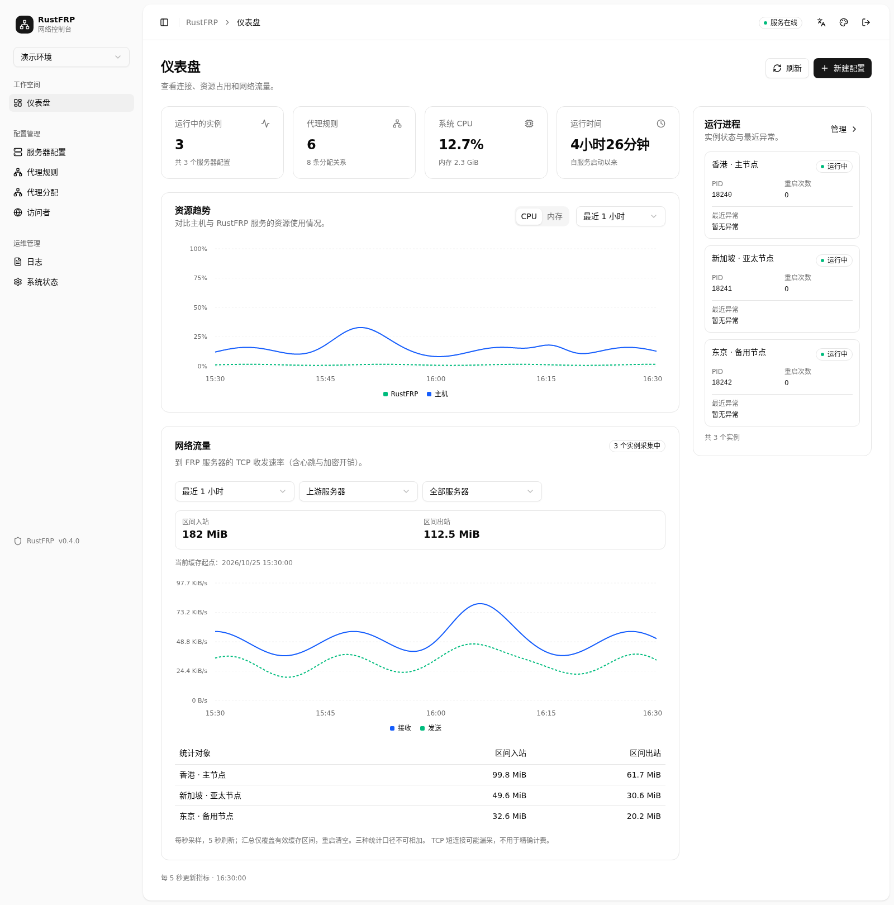
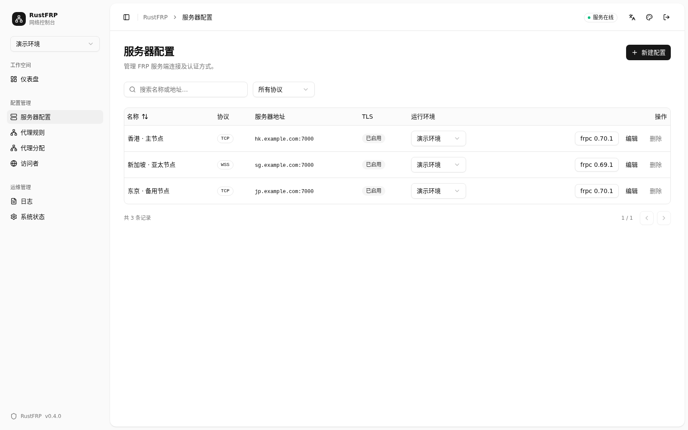
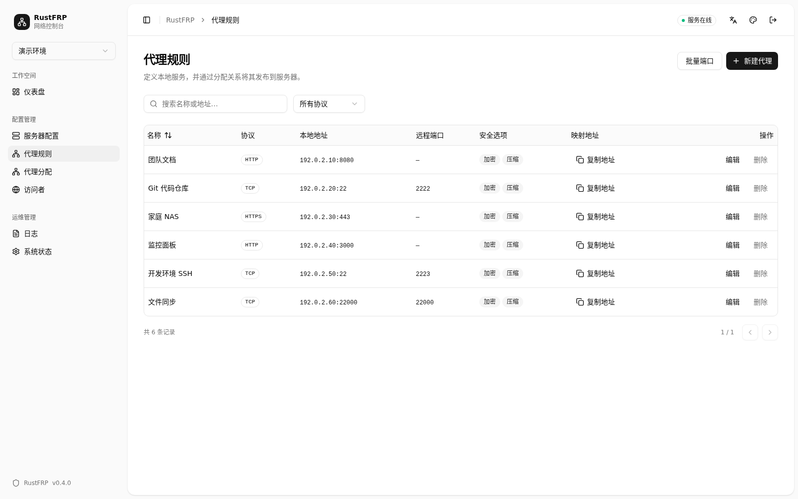
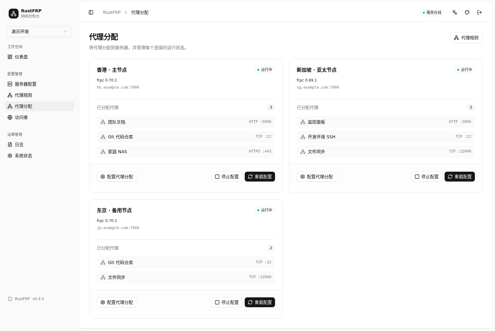
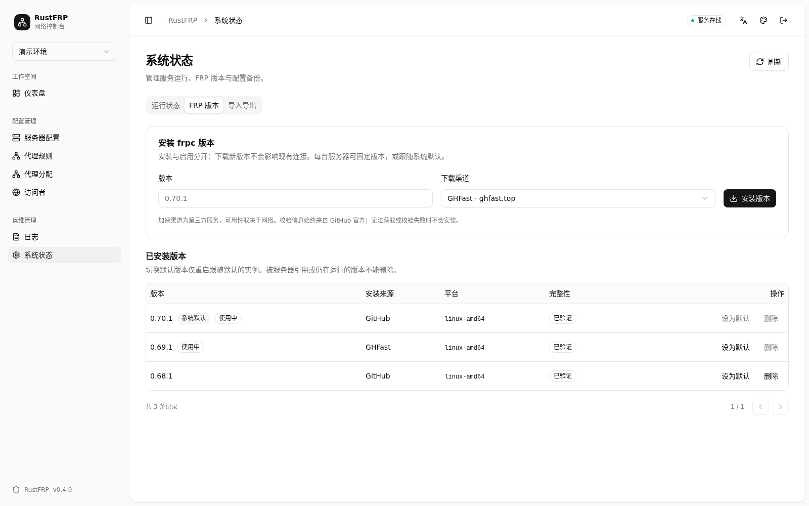
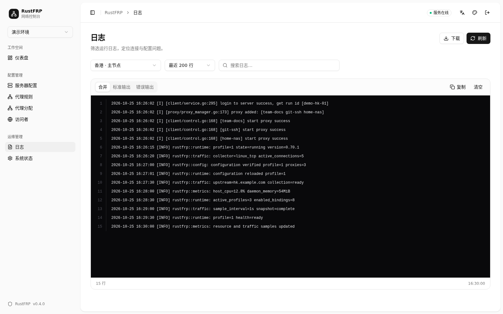

# RustFRP

[](LICENSE)
[](Cargo.toml)
[](https://github.com/TATENcn/rustfrp/actions/workflows/webui-ci.yml)

> 用一个 Web 管理台配置、运行和监控 FRP：不再手写多份 TOML，也不必逐个守护 frpc/frps 进程。

RustFRP 是一个兼容原生 FRP 的管理与运维工具，面向个人、家庭实验室和小型团队。它把服务器、代理、绑定和 Visitor 配置保存在 SQLite 中，按需生成标准 FRP TOML，并负责原生 frpc/frps 的安装、启动、热重载、故障恢复和观测。

RustFRP 不修改 FRP 协议，也不接管流量转发。已有的现代格式 `frpc.toml` 可以直接导入；底层隧道仍由原生 frpc/frps 完成。

[快速开始](#快速开始) · [核心能力](#核心能力) · [系统架构](#系统架构) · [部署说明](deploy/compose/README.md) · [开发文档](AGENTS/README.md) · [参与贡献](CONTRIBUTING.md)

## 界面预览

界面基于 React、shadcn/ui 和 Recharts，支持中文 / English、浅色 / 深色主题。

以下截图来自真实前端页面，使用隔离的演示数据：**3 台服务器、6 条代理规则、8 条分配关系**。流量曲线、运行状态和日志均为模拟内容，不代表性能测试结果。



<details>
<summary>服务器配置与代理规则</summary>

服务器可以分别固定 frpc 版本，或跟随系统默认。





</details>

<details>
<summary>代理分配与实例管理</summary>

按服务器查看代理、运行状态和 frpc 版本，执行启动、停止、重启或热重载。



</details>

<details>
<summary>frpc 安装与多版本管理</summary>

安装与启用分开，支持官方源、GHFast、GH-Proxy 和自定义 HTTPS 渠道。



</details>

<details>
<summary>日志控制台</summary>

支持实例切换、stdout/stderr 筛选、搜索、行数调整、复制和下载，并保留终端颜色。



</details>

截图可通过[演示截图脚本](plugins/webui/README.md#readme-screenshots)重新生成，不向真实管理服务写入数据。

## 为什么使用 RustFRP

- **集中管理配置**：在中英文 WebUI 中维护服务器、代理、绑定关系和 Visitor，SQLite 是唯一配置来源。
- **同时运行多个 frpc**：每个服务器配置对应独立进程；单个连接故障不会影响其他实例。
- **兼容原生 FRP**：生成标准 TOML，支持导入现有配置，不引入私有隧道协议。
- **按需安装与选择版本**：管理台无需 frpc 即可启动；安装时校验官方 SHA256，每台服务器可固定版本或跟随系统默认。
- **查看流量去向**：每秒采样，按上游服务器、本地代理或系统网卡查看速率与缓存区间汇总。
- **面向长期运行**：支持热重载、优雅退出、崩溃恢复、指数退避和结构化故障诊断。
- **可选集中运维**：可通过 Control/Agent 管理远端 frps，并接入 Prometheus、Grafana 和 Alertmanager。
- **安全地扩展**：提供 REST API、租户与权限策略，以及受权限、时间、计算量和内存限制的无 WASI 插件沙箱。

## 核心能力

| 领域 | 能力 |
| --- | --- |
| 配置管理 | Profile、Proxy、Binding、Visitor 与多环境管理；批量创建 TCP/UDP 映射；端口冲突检查 |
| FRP 协议 | TCP、UDP、HTTP、HTTPS、STCP、XTCP、SUDP、TCPMUX；Token、OIDC、`user`、`serverUser` |
| 进程守护 | 启动、停止、重启、热重载、优雅退出、崩溃恢复、重复故障归并 |
| 版本管理 | Linux、Windows、macOS 的 x86_64/arm64；后台安装；官方源、GHFast、GH-Proxy 或自定义 HTTPS 镜像；按服务器选择版本；官方校验和验证 |
| 迁移备份 | 事务化导入现代 `frpc.toml`；一致性 SQLite 备份导出 |
| 服务端管理 | Agent 主动拉取配置，ETag 缓存，`frps verify` 校验，原子切换与失败回滚 |
| 可观测性 | 资源趋势与运行进程侧栏；三种口径的流量统计；日志筛选；可选 Prometheus / Grafana |
| API 与扩展 | REST API、Token/策略鉴权、租户隔离、WASM 插件及参考插件 |

## 系统架构

RustFRP 的核心链路是：**SQLite 保存期望状态 → 生成并校验 TOML → 原生 frpc/frps 执行转发**。WebUI 和 REST API 负责管理，Daemon 负责本地进程生命周期；Control/Agent 与监控组件均为可选能力，故障时不应阻断既有 FRP 数据面。


更完整的设计约束和架构决策见 [系统架构设计](AGENTS/01-ARCHITECTURE.md)。

## 快速开始

### Docker 单容器

使用 [v0.4.0](https://github.com/TATENcn/rustfrp/releases/tag/v0.4.0) 镜像（Linux amd64 / arm64）：

```bash
export RUSTFRP_API_TOKEN="$(openssl rand -hex 32)"
# 保存这个 Token，稍后用于登录管理台
printf '%s\n' "$RUSTFRP_API_TOKEN"

docker run -d --name rustfrp --restart unless-stopped \
  -p 127.0.0.1:7900:7900 \
  -v rustfrp-data:/data \
  -e RUSTFRP_API_TOKEN \
  ghcr.io/tatencn/rustfrp:0.4.0
```

打开 <http://127.0.0.1:7900/>，输入上面的 Token。容器默认不下载 frpc，即使尚未安装 frpc，也能打开前端、编辑配置和使用管理 API。数据保存在 `rustfrp-data` 卷中。

1. 在「系统状态 → FRP 版本」选择版本和下载渠道，安装后设为系统默认。
2. 在「服务器配置」添加 frps 连接；需要时为该服务器固定 frpc 版本。
3. 在「代理规则」创建本地服务映射，再到「代理分配」将代理分配给服务器。
4. 启动实例，查看日志和流量，验证映射地址。

上面的端口仅绑定本机；远程部署可通过 SSH 转发或 TLS 反向代理访问。容器内的 `127.0.0.1` 指向容器自身，代理宿主机服务时应填写容器可达的宿主机地址。

### Docker Compose（含监控组件）

需要 frps、Control、Prometheus、Grafana 和 Alertmanager 的完整部署时，在仓库根目录执行：

```bash
mkdir -p deploy/compose/secrets
openssl rand -hex 32 > deploy/compose/secrets/rustfrp_api_token.txt
export GRAFANA_ADMIN_PASSWORD='replace-with-a-long-password'
docker compose up -d --build
```

启动后可访问：

| 服务 | 默认地址 | 用途 |
| --- | --- | --- |
| RustFRP | <http://127.0.0.1:7900/> | 配置和管理 FRP |
| Grafana | <http://127.0.0.1:3001/> | 查看集中监控仪表盘 |
| Prometheus | <http://127.0.0.1:9090/> | 查询监控指标 |
| Alertmanager | <http://127.0.0.1:9093/> | 查看和管理告警 |

Compose 会启动 daemon、frps、control 及监控组件。数据库、运行时配置、FRP 二进制和日志保存在数据卷中。增加节点、调整端口和生产部署方式见 [Compose 部署说明](deploy/compose/README.md)。

### 从源码运行

构建需要 Rust 1.95+、Bun 和 Just。管理服务启动不依赖 frpc 或下载源；实际建立隧道时才需要安装 frpc，并准备可用的 frps。

```bash
# 终端一：运行内嵌 WebUI 和 HTTP API 的 daemon
just dev-daemon

# 终端二：按需启动前端热更新
just dev-webui
```

也可以直接指定运行参数：

```bash
cargo run -p rustfrp-daemon -- \
  --config-dir ~/.rustfrp/runtime \
  --db-path ~/.rustfrp/config.db \
  --api-listen 127.0.0.1:7900 \
  --api-token <token>
```

启动后打开 <http://127.0.0.1:7900/>，按上述安装版本、配置服务器和分配代理的顺序操作。

## 配置迁移与备份

系统状态页可一次导入现代格式 `frpc.toml`，包括 Profile、Proxy、Binding 和 Visitor。导入在单个数据库事务中完成；失败不会留下不完整配置。同名 Profile 会安全重命名，Proxy 和 Visitor 的对外名称保持不变。

同一页面可以下载一致性的 SQLite 备份。备份包含认证 Token 等敏感配置，应按密钥文件保管，不要提交到 Git 或通过公开渠道传输。

```text
POST /api/v1/config/import
GET  /api/v1/config/export
```

## FRP 二进制与版本管理

在「系统状态 → FRP 版本」按需安装。下载在后台运行，页面显示进度和错误；安装本身不会切换默认版本或重启实例。版本按 `versions/<version>/<platform>/` 隔离存放。

- **下载渠道**：GitHub 官方、GHFast（`ghfast.top`）、GH-Proxy 或自定义 HTTPS 地址。第三方仅提供发布归档，SHA256 校验信息仍来自官方；获取失败或校验不符时停止安装。
- **服务器版本**：每个服务器配置对应一个 frpc 进程，该服务器下的代理共用版本。在服务器列表点击版本按钮，选择固定版本或跟随系统默认；保存后点击「重启并应用版本」生效。
- **系统默认**：切换默认版本仅重启跟随默认的运行实例，固定版本实例不受影响。切换失败会恢复原默认并尝试恢复相关进程。
- **删除保护**：被配置引用、当前默认或仍有进程运行的版本不能删除。

默认离线启动管理服务。旧参数 `--no-auto-download` / `RUSTFRP_NO_AUTO_DOWNLOAD=true` 继续兼容；只有显式设置 `--auto-download` / `RUSTFRP_AUTO_DOWNLOAD=true` 才在启动时下载，此时可通过 `RUSTFRP_FRP_VERSION` 指定下载版本，启动可能等待网络。

详见 [frpc 版本与安装渠道](docs/frpc-versions.md)。

## 流量与资源监控

仪表盘展示 CPU / 内存趋势，右侧集中展示运行实例与最近异常。网络流量**后台每 1 秒采样，页面每 5 秒刷新**，可切换三种统计口径：

| 口径 | 查看内容 |
| --- | --- |
| 上游服务器 | 当前环境全部或单个服务器的 TCP 收发速率、区间汇总，包含心跳与加密开销 |
| 本地代理 | 按服务器及代理分别统计，可汇总同一代理在不同服务器上的流量 |
| 系统网卡 | 守护进程所在网络命名空间的收发量，可筛选出口网卡；容器内不一定等同于物理宿主机 |

三种口径不能相加。历史仅保存在内存中，最多保留最近一小时，每类上限 36,000 条样本，多对象共享容量；服务重启后清空。区间汇总只包含有效采样，不是日/月账单。

上游流量采集当前支持 Linux 上直连的 TCP / WebSocket / WSS；短连接可能漏采，UDP、QUIC 等不适用。完整支持范围、统计方向和排查方法见 [网络流量监控](docs/traffic-monitoring.md)。

## 可选的 frps Agent

Control 以只读方式从模板目录提供 `<node-id>.toml`，Agent 使用 Bearer Token 主动拉取。候选配置通过 TOML 检查及 `frps verify` 后才会原子替换；Control 不可用时继续使用最后一份有效缓存。Agent 退出不会终止 frps，重启后可以通过 PID 文件接管进程。

```bash
export RUSTFRP_AGENT_TOKEN='replace-with-a-long-random-token'

# Control
cargo run -p rustfrp-control -- \
  --templates-dir ./deploy/agent/templates \
  --targets ./targets.json

# frps 节点；不传 --frps-path 时自动下载并校验官方 frps
cargo run -p rustfrp-agent -- \
  --node-id edge-1 \
  --control-url http://control.example.com:3000
```

模板 Pull API 支持 ETag/`If-None-Match`。生产环境应在 Control 前启用 TLS 反向代理。

## 项目结构

```text
crates/
├── client/           # SQLite CRUD、TOML 生成、进程守护
├── rustfrp-bin/      # FRP 二进制下载、校验、解压与版本管理
├── rustfrp-daemon/   # HTTP API、内嵌 WebUI 和本地管理入口
├── rustfrp-sdk/      # 插件 SDK
├── common/           # 日志、信号、错误和插件运行时
└── server/
    ├── control/      # 指标拉取和 Agent 配置模板 API
    └── agent/        # frps 配置拉取、校验、缓存与进程守护
plugins/
├── webui/            # React + shadcn/ui + Vite 管理界面
└── official/         # 官方参考 WASM 插件
```

## 开发与测试

Linux 下可使用统一的 Bun 开发管理入口，自动构建 WebUI / daemon 并提供本机及局域网 HTTPS 预览：

```bash
bun run mode:start    # 构建并后台启动
bun run mode:status   # 查看真实地址与健康状态
bun run mode:reload   # 重新构建并重启
bun run mode:stop     # 停止，保留数据
bun run mode:help     # 中文分组帮助
```

首次访问需要信任本地自签证书，并在界面填写 `.local/mode/api-token` 中的 Token。管理器使用独立开发数据库；完整命令、隔离边界及证书信任说明见 [Bun 开发管理指南](docs/development-mode.md)。

```bash
just test-fast             # 快速单元测试
just test-all              # 全量测试（含集成测试）
just lint                  # rustfmt --check + clippy
just dev-webui             # 前端开发模式
just build-release         # 发布构建
bash scripts/e2e-local.sh  # 双 frps + 双 frpc 本地闭环测试
```

项目使用 `dev` 作为默认开发分支。请从 `dev` 创建短期分支，并向 `dev` 提交 Pull Request；只有发布 PR 可以从 `dev` 合入 `main`。完整流程见 [贡献指南](CONTRIBUTING.md)。

## 文档

- [frpc 版本与安装渠道](docs/frpc-versions.md)
- [网络流量监控](docs/traffic-monitoring.md)
- [Bun 开发管理指南](docs/development-mode.md)

- [架构与 ADR](AGENTS/01-ARCHITECTURE.md)
- [硬性约束](AGENTS/02-CONSTRAINTS.md)
- [开发规范](AGENTS/03-DEVELOPMENT.md)
- [CI/CD 与发布](AGENTS/05-CICD.md)
- [部署指南](AGENTS/06-DEPLOYMENT.md)
- [界面设计](AGENTS/07-UI-DESIGN.md)
- [安全设计](AGENTS/08-SECURITY.md)

## 许可证

[AGPL-3.0-only](LICENSE) © RustFRP contributors
